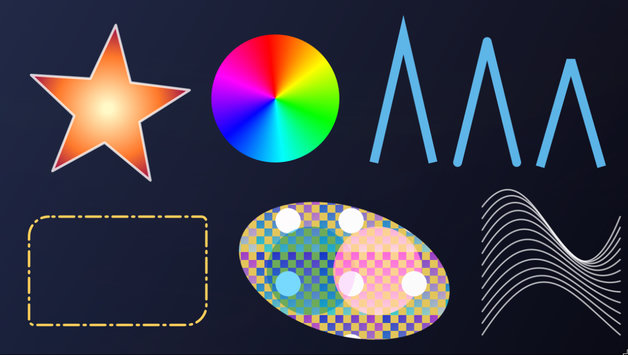
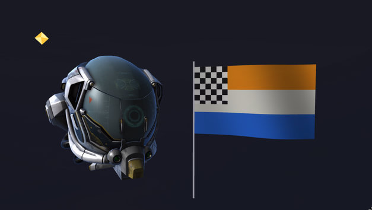
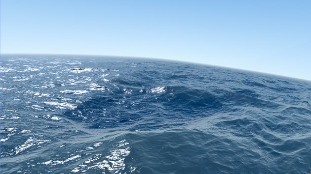

<div align="center">

# fatmap

### A GPU-class renderer that runs on your CPU.

HTML canvas 2D, a fixed function and programmable 3D pipeline, and SPIR-V shaders,<br>
in pure C11. SIMD accelerated, multithreaded, bit-exact on every platform.

**Windows + Linux + macOS** &nbsp; | &nbsp; **x86_64 + arm64** &nbsp; | &nbsp; **SSE2 / AVX2 / AVX-512 / NEON** &nbsp; | &nbsp; **MIT licensed**

[Get it](#using-fatmap-in-your-project) &nbsp; / &nbsp; [Quick start](#quick-start-c) &nbsp; / &nbsp; [SPIR-V shaders](#spir-v) &nbsp; / &nbsp; [fatgl (OpenGL 3.3)](https://github.com/xls/fatgl) &nbsp; / &nbsp; [Releases](https://github.com/xls/fatmap/releases)

</div>

<table>
<tr>
<td width="33%"></td>
<td width="33%"></td>
<td width="33%"></td>
</tr>
<tr>
<td align="center"><sub><b>2D canvas</b>: gradients, strokes, dashes, patterns, composite ops</sub></td>
<td align="center"><sub><b>3D</b>: textured glTF meshes and shaders</sub></td>
<td align="center"><sub><b>Shadertoy's Seascape</b>: SPIR-V compiled to machine code by the JIT</sub></td>
</tr>
</table>

No GPU, no driver, no system dependencies. Draw paths and gradients like an
HTML canvas, render textured, lit, multisampled 3D scenes, or run GLSL
compiled to SPIR-V: interpreted, ahead of time compiled to C, or JIT compiled
to AVX2 / AVX-512 machine code. Every SIMD level and every thread count
renders the same image, so it doubles as a reference renderer for tests and CI.

Named after Mats Byggmastar's classic *fatmap* texture mapping articles,
whose ideas (constant gradients, sub-pixel correct edge setup, fixed point
stepping) still live in the core.

## Need OpenGL? Use fatgl

**[fatgl](https://github.com/xls/fatgl)** is an OpenGL 3.3 driver for
Windows built on fatmap. Put its `opengl32.dll` next to an application's
`.exe` and the application renders through fatmap: no relinking, no GPU
driver. GLSL is compiled at run time to SPIR-V and run by fatmap's JIT.
It runs Doom 3 BFG Edition, shaders, shadow volumes and all.

## Architecture

The library is layered so the low level pieces can be used on their own, for
example as the software backend of an OpenGL / Direct3D style API:

```
 fatmap++ (C++17 header wrapper)       bindings (rust, python, ...)
        |                                      |
 fm2d  - HTML canvas API: paths, strokes, dashes, gradients, patterns,
         clipping, 27 composite ops, drawImage, Path2D, hit testing
 fm3d  - fixed function 3D: clipping, culling (front / back / both), depth
         (32F, bias, range), two sided stencil, perspective correct
         texturing, nearest / bilinear / trilinear mipmaps, texenv combine,
         alpha test, color write mask, any blend op, MSAA 4x / 8x, tile
         binned multithreaded rasterizer
        |
 fm_exec  - command lists + executors (multithreaded, optional)
 fm_pipe  - op based pixel pipeline: fetch -> coverage -> blend -> store
            samplers (nearest / bilinear, repeat / clamp / mirror / border)
 fm_raster- coverage rasterizer: analytic AA or GL/D3D point sampling,
            nonzero / even-odd, row-range rendering
 fm_core  - surfaces (ARGB32, A8, D32F), swapchain, colors, blend kernels,
            CPU detection, SIMD dispatch
 fm_math  - glm compatible vec/mat/quat (header only)
 fm_profile - built-in zone profiler (+ optional Tracy)
```

## Using fatmap in your project

Prebuilt static libraries are attached to every
[release](https://github.com/xls/fatmap/releases): Windows x64 (MSVC and
MinGW), Linux x64 / arm64 and macOS arm64 / x64. Each archive holds the
headers (C and C++), the library, pkg-config files and a CMake package:

```cmake
find_package(fatmap 0.11 REQUIRED)          # -DCMAKE_PREFIX_PATH=<unpacked dir>
target_link_libraries(app PRIVATE fatmap::fatmap)    # or fatmap::fatmapxx for C++
```

```meson
fatmap = dependency('fatmap')              # --pkg-config-path <unpacked dir>/lib/pkgconfig
```

It also works as a Meson subproject (`subprojects/fatmap.wrap`), and
`python tools/package.py` builds a package locally. See
[docs/PACKAGING.md](docs/PACKAGING.md) for all options.

## Building

Meson + Ninja, no system dependencies. `bootstrap` installs Meson and Ninja
into a private venv (`.tools/`), fetches third party code into `external/`
(SDL3 for the sandbox, glm for the C++ tests, optionally Tracy) and builds.

```sh
./bootstrap.sh              # Linux / macOS / MSYS
bootstrap.cmd               # Windows (uses whatever compiler is on PATH)
bootstrap.cmd --msvc        # Windows, force Visual Studio (build-msvc/)
python bootstrap.py --help  # --debug, --profile, --tracy, --no-sandbox, --test ...
```

After bootstrapping, rebuild with `.tools/Scripts/meson compile -C build`
(or `.tools/bin/meson` on Linux/macOS).

Meson options (`-Doption=value`):

| option    | default | meaning |
|-----------|---------|---------|
| `threads` | auto    | thread pool executor; `disabled` needs no thread library |
| `profile` | true    | compile built-in profiler zones |
| `tracy`   | false   | forward zones to Tracy (`bootstrap --tracy`) |
| `sandbox` | auto    | SDL3 sandbox app |
| `tests`   | true    | tests + benchmark |
| `vbo`     | true    | 3D vertex buffers (`fm3d_buffer`) |
| `tnl`     | true    | 3D fixed function lighting |
| `shaders` | true    | 3D programmable stages (vertex / fragment callbacks) |
| `spirv`   | true    | SPIR-V shaders on the programmable stages (needs `shaders`) |

`vbo`, `tnl` and `shaders` compile in or out completely: a lean build
(`-Dvbo=false -Dtnl=false -Dshaders=false`, which also drops `spirv`) contains none of their code, and
the installed `fatmap/fm_config.h` (`FM_FEATURE_VBO` / `_TNL` / `_SHADERS`)
tells consumers what a build has; a disabled feature's API is not declared.

Tested: Windows x64 (GCC 15 / MinGW, MSVC 19.5x), Linux x64 and Linux
AArch64 (GCC, Alpine and Ubuntu containers; AArch64 under QEMU); CI adds
macOS arm64 / x64.

## Quick start (C)

```c
#include <fatmap/fatmap.h>

fm_surface* fb  = fm_surface_create(1280, 720, FM_FORMAT_ARGB32);
fm2d_ctx*   ctx = fm2d_create(fb);

fm2d_clear(ctx, FM_RGB(20, 20, 30));
fm2d_paint* g = fm2d_paint_linear(0, 0, 400, 0);
fm2d_paint_add_stop(g, 0, FM_RGB(255, 0, 0));
fm2d_paint_add_stop(g, 1, FM_RGB(0, 0, 255));
fm2d_set_fill_paint(ctx, g);
fm2d_begin_path(ctx);
fm2d_arc(ctx, 200, 200, 150, 0, 6.2831853f, 0);
fm2d_fill(ctx, FM_FILL_NONZERO);
fm2d_paint_release(g);

fm_surface_write_png(fb, "out.png");
```

## Quick start (C++)

```cpp
#include <fatmap/fatmap.hpp>

fm::Surface  fb(1280, 720);
fm::Canvas2D ctx(fb);
auto grad = fm::Canvas2D::createLinearGradient(0, 0, 400, 0);
grad.addColorStop(0, "red").addColorStop(1, "#00f");
ctx.fillStyle(grad);
ctx.beginPath();
ctx.arc(200, 200, 150, 0, 2 * fm::pi);
ctx.fill();
```

## Quick start (3D)

```c
fm_swapchain* sc  = fm_swapchain_create(1280, 720, 2, 1); /* double buffer + depth */
fm3d_ctx*     ctx = fm3d_create();
fm3d_texture* tex = fm3d_texture_create(image, 1);          /* with mipmaps */

fm3d_set_target(ctx, fm_swapchain_back(sc), fm_swapchain_depth(sc));
fm_mat4 proj = fm_perspective(fm_radians(60), 16.0f / 9, 0.1f, 100);
fm_mat4 view = fm_lookat(fm_v3(0, 2, 5), fm_v3(0, 0, 0), fm_v3(0, 1, 0));
fm3d_set_projection(ctx, &proj);
fm3d_set_view(ctx, &view);
fm3d_sampler s = { FM3D_FILTER_TRILINEAR, FM_WRAP_REPEAT, FM_WRAP_REPEAT, 0, FM_WRAP_REPEAT };
fm3d_set_texture(ctx, tex, &s);
fm3d_set_cull(ctx, FM3D_CULL_BACK, FM3D_FRONT_CCW);
fm3d_clear_color(ctx, FM_RGB(0, 0, 0));
fm3d_clear_depth(ctx, 1.0f);
fm3d_draw_indexed(ctx, vertices, nverts, indices, nindices);
fm_surface* frame = fm_swapchain_present(sc);              /* display this */
```

Rendering always goes to a back buffer; `fm_swapchain_present` swaps and
returns the finished frame, so it can be uploaded or displayed while the
next frame renders.

Meshes drawn every frame can live in a vertex buffer (like a GL VBO / IBO):
`fm3d_buffer_create(vertices, nverts, indices, nindices)` copies once, then
`fm3d_draw_buffer(ctx, buf, first, count)` draws by reference, with no per
draw copy or index validation (in deferred mode the buffer stays alive
until the flush, even if released). With 2000 small draws per frame this is
~10 % faster at 32 threads than `fm3d_draw`, which must copy.

### Lighting (T&L) and shaders

With `tnl`, `fm3d_set_lighting` enables GL 1.x style per vertex lighting:
up to 8 directional / point / spot lights (`fm3d_set_light`, world space),
a material (`fm3d_set_material`), global ambient and color material. It runs
as one SIMD kernel written once for all backends (bit identical results).

With `shaders`, `fm3d_set_program` replaces either stage with a C callback:
the vertex shader gets blocks of vertices in any layout
(`fm3d_draw_vertices(ctx, data, stride, count, indices, n)`) and writes clip
positions + up to 64 varyings; the fragment shader gets 2 x 32 pixel batches
(SoA varyings, depth, coverage mask) and writes RGBA, optionally discarding.
Uniforms are copied per draw (`fm3d_set_uniforms`), `fm3d_sample` gives
fragment shaders the texture sampler. A NULL stage is the fixed function
one, so the stages mix. This is the interface a SPIR-V backend will target.

```c
static void fs_tint(const fm3d_fs_io* io)
{
    const float* tint = (const float*)io->uniforms;
    for (int i = 0; i < FM3D_BATCH_PIXELS; i++)
        for (int k = 0; k < 4; k++) io->out[k][i] = io->varyings[2 + k][i] * tint[k]; /* vertex rgba */
}
fm3d_program p = { NULL, fs_tint, 0, 0, NULL, 0, 0, 0, 0, 0 }; /* fixed vertex stage + custom fragment stage */
fm3d_set_program(ctx, &p);
fm3d_set_uniforms(ctx, (float[4]){ 1, 0.5f, 0.5f, 1 }, 4 * sizeof(float));
```

### API layers (OpenGL / Direct3D conventions)

Two switches let a graphics API run on fatmap without converting images:
`fm3d_set_origin(ctx, FM3D_ORIGIN_LOWER_LEFT)` counts rows bottom up as
OpenGL does (viewport, scissor, `gl_FragCoord`, `dFdy`, winding), so render
to texture output is laid out the way GL samples it; and
`fm3d_set_blend_state` switches the output merger to straight (not
premultiplied) colors with OpenGL / Direct3D blend factors and equations
(`glBlendFuncSeparate`, `glBlendEquationSeparate`, `glBlendColor`), one
SIMD kernel for every backend. [fatgl](https://github.com/xls/fatgl), the
OpenGL 3.3 driver on fatmap, uses both.

### SPIR-V

With `spirv` (needs `shaders`), vertex / fragment SPIR-V modules run on the
programmable stages: compile GLSL with `glslc shader.frag -o shader.spv`
(function calls are inlined when the module is created), then

```c
fm3d_vertex_attrib attr[] = { { 0, 3, 0 }, { 1, 4, 12 } }; /* location, floats, byte offset */
char        err[256];
fm3d_spirv* p = fm3d_spirv_create(vs_words, vs_count, fs_words, fs_count, attr, 2, err, sizeof(err));
fm3d_program prog = fm3d_spirv_program(p);
fm3d_set_program(ctx, &prog);
fm3d_set_uniforms(ctx, &ubo, sizeof(ubo));               /* the std140 uniform block */
fm3d_set_texture_unit(ctx, 1, tex, &sampler);            /* layout(binding = 1) sampler2D */
fm3d_draw_vertices(ctx, verts, sizeof(*verts), n, indices, ni);
```

A batch interpreter runs each instruction over 64 lanes (64 fragments or
vertices) with lane masks for structured control flow, so helper pixels
keep derivatives exact. Supported: GLSL.std.450 shaders with scalars,
vectors, matrices, arrays, structs, function calls, uniform blocks by
binding (up to 16: `fm3d_set_uniform_block`) or push constants, `sampler2D`
(implicit / explicit LOD), inputs / outputs by location, `gl_Position`,
`gl_VertexIndex` / `gl_InstanceIndex` (`fm3d_set_draw_ids`),
`gl_FragCoord`, `discard`, `dFdx` / `dFdy` / `fwidth`,
`if` / loops / `switch` and the common GLSL functions; anything else is
rejected at creation with a message. Either stage may be NULL (the fixed
function stage, which never goes through SPIR-V). `tools/compile_shaders.py`
embeds compiled shaders as C arrays (see `tests/spirv`, `sandbox/shaders`).

#### Ahead of time: SPIR-V to C

The same program can be compiled to C, at build time or offline:

```sh
fm-spirvc -n water --vs water.vert.spv --fs water.frag.spv -a 0:3:0 -a 1:2:12 -o water_shader.c
```

```c
fm3d_program water_program(void);        /* defined by water_shader.c */
fm3d_program p = water_program();
fm3d_set_program(ctx, &p);               /* no SPIR-V or interpreter at run time */
```

(or `fm3d_spirv_to_c()` from code). The generated stages run the same 64
lane batches: control flow becomes plain C over lane masks, lane uniform
values (uniform block loads, constants) are scalars computed once, and
each block's instructions fuse into loops over the lanes that the C
compiler vectorizes. The output needs only `-Dshaders` (not `-Dspirv`),
and with the same floating point settings (`-O3 -ffp-contract=off`, MSVC
`/O2 /fp:precise`; no fast math) it renders bit for bit what the
interpreter renders (tested, including Seascape).

Shader math (`fatmap/fm_vmath.h`): sin / cos / tan / exp / exp2 / log /
log2 / pow (within 1 ulp), floor / ceil / trunc / round / rint and fmin /
fmax (exact) as straight line code, so loops calling them vectorize and
the results are the same bits on every platform and compiler (the C
library's are neither). Both shader backends use them; C shaders can too.

Both backends exist per instruction set (SSE2 / NEON baseline, AVX2,
AVX-512; the interpreter as separately compiled units, the generated C as
`target` attribute variants with GCC / Clang) and follow `fm_simd_current()`;
every level renders the same image. `fm3d_spirv_set_fast_math(p, 1)`
switches a program to `fm_fast_*` math (float, GPU like precision inside
Vulkan's limits): about 1.4x faster, still deterministic.

Seascape (TDM, Shadertoy; `tests/spirv/seascape.frag`, a ray marcher),
480x270, ms per frame on a Ryzen 9 9950X3D (one thread pinned to one CCD;
32 threads unpinned), with Mesa llvmpipe (LLVM JIT) on the same machine as
the reference:

| | SSE2 | AVX2 | AVX-512 | 32 threads |
|---|---|---|---|---|
| interpreter, C library math (first version) | 3967 | | | |
| interpreter | 642 | 344 | 258 | 14.7 |
| interpreter, fast math | | 224 | 181 | 12.0 |
| compiled to C (AOT) | 514 | 257 | 165 | 8.2 |
| compiled to C, fast math | | 181 | 125 | 6.0 |
| **JIT** | | 238 | 174 | 9.3 |
| **JIT, fast math** | | 119 | 112 | 5.6 |
| Mesa 25 llvmpipe (LLVM 19) | | 59 | | 4.1 |

(2026-10-10; the 32 thread column includes smaller tiles for small drawn
areas, which took the JIT from 7.3 to 5.6 ms.)

llvmpipe is still about 2x faster on one thread here. Seascape is almost
pure math (a ray marcher), the case an optimizing compiler wins: LLVM fuses
multiply-adds, hoists loop invariant work, splits live ranges and uses
approximate reciprocals, while fatmap's JIT keeps the interpreter's exact
operation order (no FMA, no reassociation) so every backend renders the
same bits. On a texture heavy game like scene (Doom 3 BFG light
interactions through fatgl) the gap is ~1.1x on one thread and fatmap is
ahead on 32 threads; see [docs/PERF.md](docs/PERF.md).

#### JIT

Shaders loaded at run time are compiled to x86 machine code (x86-64 and
x86-32, AVX2 / AVX-512) by default (`-Djit=true`). Programs the JIT does
not cover, and CPUs without AVX2, fall back to the interpreter; every mode
renders the same bits. `fm3d_spirv_set_jit(p, 0)` or `FM_JIT=0` forces the
interpreter, `fm3d_spirv_jit_error(p)` says why a program was not JIT
compiled. Seascape (fast math) runs faster than the compiled to C code,
112 ms per frame single threaded on AVX-512 (see the table above and
[docs/PERF.md](docs/PERF.md)).

### 3D pipeline design

```
vertex stage -> clip (homogeneous, near/far + guard band) -> cull -> viewport
 -> setup (fatmap constant gradients: planes for z, 1/w, varyings/w;
    28.4 fixed point edges, top-left rule)
 -> raster in 2x2 quads (row pairs) into SoA fragment batches
 -> early z -> fragment stage (texenv, mip LOD from quad derivatives)
 -> alpha test / late z -> output merger (any blend op) -> back buffer
```

The stages exchange generic float varyings and the fragment stage works on
2x2 quads, so fixed function T&L (lighting) and programmable shaders
(SPIR-V) can replace the fixed vertex / fragment stages later without
changing the rasterizer. Vertices already carry normals.

## Multithreading

Contexts, rasterizers, pipelines and command lists are independent objects:
use one per thread freely. For parallel rendering of one frame, switch a
context to deferred mode:

```c
fm_executor* ex = fm_executor_create(0);   /* 0 = one worker per CPU, N = at most N */
fm2d_set_deferred(ctx, 1);
fm2d_set_executor(ctx, ex);
... draw ...
fm2d_flush(ctx);                           /* executes the command list */
```

Draws are recorded into an `fm_cmdlist`, then executed in two parallel
phases: geometry (flatten / stroke / edge build, per command) and raster
(per 32-row strip, all commands in order, no locks). The result is
bit-identical to immediate mode for any thread count.

The pool size is the `fm_executor_create` argument (the calling thread counts
as one worker). An executor is not tied to a context: one pool can serve any
number of 2D and 3D contexts (flushes from different threads take turns on
the pool). In C++:

```cpp
fm::Executor pool(4);          // at most 4 workers
fm::Canvas2D ctx(surface);
ctx.executor(pool);
ctx.deferred(true);
... draw ...
ctx.flush();
```

3D works the same way (`fm3d_set_deferred` / `fm3d_set_executor` /
`fm3d_flush`) with three phases: vertex processing, setup + tile binning
(per triangle chunk) and per tile rasterization (64x64 by default: color and
depth of a tile stay in cache, tiles never share pixels). With
`-Dthreads=disabled` the same code runs serially; platforms with their own
task system can plug in an `fm_executor` with a custom `parallel_for`.

Rules in deferred mode (as with GPU APIs): pixels are valid after
`fm2d_flush`, and images drawn must not change until then. Gradients and
patterns are snapshotted automatically. Drawing the target onto itself
flushes first.

## SIMD

Every kernel exists for scalar, SSE2, AVX2 (x86, runtime selected) and NEON
(AArch64). The op formulas live in one template (`src/core/fm_kernels_tmpl.h`)
instantiated per backend, and every backend is tested to be bit-identical to
scalar. Force a level with `fm_simd_set()` or the `FM_SIMD` environment
variable (`scalar`, `sse2`, `avx2`, `neon`).

What runs through the kernels: 2D coverage accumulation and long edge runs,
all fills / blends / masks, gradients and bilinear sampling; in 3D the
depth / stencil tests, plane interpolation of z, 1/w and varyings, texture
coordinates, sampling, texenv, color packing, and MSAA resolve. The
remaining scalar loops are the 2D edge walk (scattered writes), per sample
MSAA bookkeeping and triangle setup. `fm_kernel_test` checks each table
entry against scalar directly.

## Profiling

* `fm_profile.h`: zones per draw call (`2d.fill`, `2d.stroke`, `cmd.raster`,
  ...), `fm_prof_report()` prints a table. Press `P` in the sandbox.
* `fm_bench`: every workload at every SIMD level, plus command list serial
  and multithreaded columns. `--csv`, `--prof`, `--threads`, `--strip`.
* `bootstrap --profile` builds `build-prof/` (optimized + symbols) for VTune,
  Superluminal, perf or Instruments; `bootstrap --tracy` enables Tracy.

See `docs/PERF.md` for current numbers.

## Sandbox

`fatmap_sandbox` (SDL3, 1280x720, renders into a swapchain): keys `1`-`9` and
`0` pick scenes (7 = 3D, 8 = troll, 9 = animated glTF characters, 0 = glTF
helmet), `S` SIMD level, `T` threads, `A` anti-aliasing, `B` bilinear, `F` 3D
texture filter, `M` perspective correction, `N` MSAA, `C` fox animation clip,
`Up`/`Down` object count, `P` profiler, `V` vsync. `--shots <dir>` renders every
scene single and multithreaded, prints timings and saves PNGs (handy for CI).

Sample assets live in `data/` (Khronos glTF samples, see
[data/README.md](data/README.md) for licenses; the troll of scene 8 is not
redistributable and not included). The sandbox decodes JPEG / PNG with the
single header `sandbox/stb/stb_image.h`; the library has no image decoder
dependency.

## Tests

`meson test -C build` runs `fm_test` (SIMD equivalence for all 27 blend ops,
coverage accuracy, fill rules, AA modes, strokes, dashes, blend math,
gradients, clipping, images, hit testing, CSS colors, deferred / threaded
equivalence), `fm3d_test` (fill convention, depth, culling, near plane
clipping, perspective correctness against ray casting, mipmaps, immediate vs
tiled multithreaded equality for several tile sizes and thread counts) and
`fm_cpp_test` (C++ wrapper, fm_math vs glm).

## Status

Done: core, SIMD kernels, rasterizer, pipeline, 2D canvas API, command
lists + threading, fixed function 3D with tiled threading, swapchain,
sandbox, bench, C++ wrapper (2D + 3D).

Done since: fog, multitexture, 16 lane groups, AVX-512 shader backends,
layered textures, color masks. Next: docs/BACKLOG.md (parity with Mesa
llvmpipe, canvas text / shadows / filters, fatgl).
